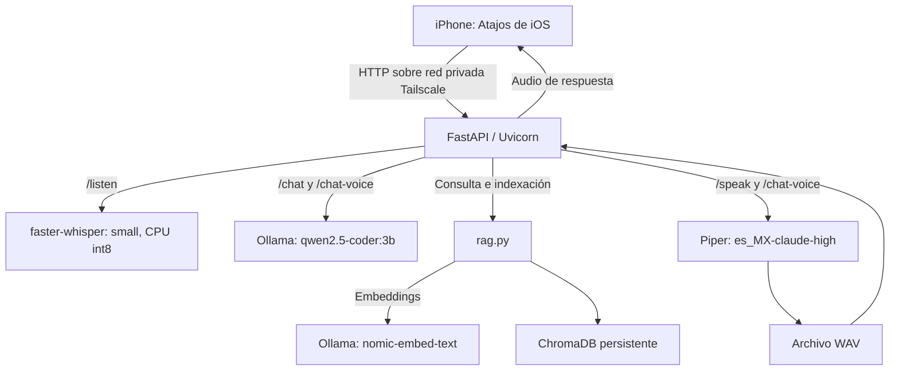

# Local AI Assistant: documentación técnica

## Descripción del proyecto

Local AI Assistant es un asistente personal que combina conversación de texto, transcripción de audio, generación de voz y consulta de documentos propios. El procesamiento de los modelos y la base de conocimiento se ejecutan en la máquina del usuario, sin enviar las consultas a una API de inferencia externa.

El entorno de uso descrito por el autor es una laptop con Windows, WSL Ubuntu 24.04 y una GPU NVIDIA RTX 3050 de 4 GB de VRAM. El acceso desde el iPhone se realiza mediante Atajos de iOS y una red privada Tailscale. Esta configuración es una referencia de uso, no un requisito mínimo medido ni una garantía de rendimiento.

Este documento describe el código publicado en el commit `3bfc87081fd0ce283b1ebf8259bfb30c92f536b2` y la integración móvil descrita por el autor. Las funciones futuras se distinguen de las implementadas.

## Arquitectura



FastAPI coordina los componentes. Ollama ofrece generación de texto y embeddings mediante HTTP en `localhost:11434`. ChromaDB se utiliza como cliente embebido con persistencia local; no requiere un servidor Chroma independiente en esta implementación. Piper se invoca como proceso externo y Whisper se ejecuta dentro del proceso Python.

## Componentes y archivos

| Archivo | Responsabilidad |
| --- | --- |
| [backend/main.py](../backend/main.py) | Rutas HTTP, validación de entrada, construcción del prompt e historial |
| [backend/rag.py](../backend/rag.py) | Embeddings, almacenamiento y búsqueda de documentos |
| [backend/stt.py](../backend/stt.py) | Transcripción de audio en español |
| [backend/tts.py](../backend/tts.py) | Ejecución de Piper y creación de archivos WAV |
| [backend/index_documents.py](../backend/index_documents.py) | Indexación recursiva de archivos Markdown y texto |
| `backend/voices/` | Modelo ONNX y configuración de la voz utilizada por el backend |
| `backend/chroma_db/` | Datos persistentes de ChromaDB |
| `backend/audio_output/` | Audios generados por el backend |
| `tts/` | Voces y audios de prueba adicionales |

## Modelos y configuración

| Componente | Configuración actual |
| --- | --- |
| Generación de texto | `qwen2.5-coder:3b` por defecto |
| URL de generación | `http://localhost:11434/api/generate` |
| Embeddings | `nomic-embed-text` |
| URL de embeddings | `http://localhost:11434/api/embeddings` |
| Colección Chroma | `knowledge_base` |
| Transcripción | Whisper `small`, `device="cpu"`, `compute_type="int8"` |
| Idioma de transcripción | Español, `language="es"` |
| Síntesis de voz | Piper con `es_MX-claude-high.onnx` |

El modelo de generación se puede cambiar por solicitud mediante el campo `model`, siempre que esté disponible en Ollama. No existe ruteo automático entre modelos.

El prompt del sistema orienta al asistente a desarrollo web y ciencia de datos, con respuestas técnicas, ejemplos de código y explicación de alternativas. Los parámetros de conexión y modelos están definidos en el código; no hay una capa de configuración por variables de entorno.

## Flujos de procesamiento

### Chat de texto

1. El cliente envía un mensaje y un identificador de sesión.
2. Si `use_rag` está activo, se consultan documentos similares.
3. Se construye un prompt con instrucciones del sistema, documentos recuperados, hasta los últimos cinco turnos y el mensaje actual.
4. Ollama genera la respuesta en streaming.
5. El backend extrae los fragmentos `response` de las líneas JSON de Ollama y los entrega como texto.
6. Al finalizar, se incorpora el turno al historial.

La respuesta de `/chat` es `text/plain`; no es SSE ni expone directamente el formato JSON de Ollama.

### Conversación desde el iPhone

El flujo completo se compone de dos solicitudes:

```text
Grabar audio
    → POST /listen
    → extraer el campo text
    → POST /chat-voice con message
    → reproducir el WAV recibido
```

`/chat-voice` recibe texto, no una grabación. Espera la respuesta completa de Ollama, la añade al historial, ejecuta Piper y devuelve el archivo de audio.

### Recuperación de conocimiento: RAG

Al indexar, el backend solicita un embedding del texto a Ollama y guarda identificador, vector, documento y metadatos en ChromaDB.

Al buscar, genera el embedding de la consulta y recupera hasta tres documentos. Si la colección está vacía o la consulta está en blanco, devuelve una lista vacía. El número de resultados se limita al número de documentos disponibles.

La implementación almacena cada documento completo como una unidad. No realiza fragmentación, filtrado por umbral de similitud ni devolución de citas al cliente. El historial conversacional y la base documental son mecanismos distintos.

## API HTTP

| Método | Ruta | Entrada | Salida |
| --- | --- | --- | --- |
| GET | `/health` | Sin cuerpo | `{"status":"ok"}` |
| POST | `/documents` | JSON con `text` y `metadata` opcional | Identificador y estado `indexed` |
| POST | `/chat` | JSON de chat | Texto en streaming |
| POST | `/chat-voice` | JSON de chat | Archivo `audio/wav` |
| POST | `/listen` | Formulario multipart con archivo `audio` | JSON con `text` |
| POST | `/speak` | JSON con `text` | Archivo `audio/wav` |
| GET | `/chat/history/{session_id}` | Sesión en la ruta | Lista de turnos |
| DELETE | `/chat/history/{session_id}` | Sesión en la ruta | Estado `cleared` |

### Solicitud de chat

```json
{
  "message": "Explica cómo organizar una API con FastAPI",
  "session_id": "iphone",
  "model": "qwen2.5-coder:3b",
  "use_rag": true
}
```

Solo `message` es obligatorio. Los valores predeterminados son `session_id="default"`, el modelo 3B y `use_rag=true`. Para separar conversaciones, cada cliente debe utilizar su propia sesión.

### Ejemplos con curl

Ejecutar desde una terminal con acceso al backend:

```bash
# Comprobar que la aplicación responde
curl http://localhost:8000/health

# Chat de texto
curl -N http://localhost:8000/chat \
  -H 'Content-Type: application/json' \
  -d '{"message":"Hola","session_id":"terminal","use_rag":false}'

# Transcribir una grabación existente
curl http://localhost:8000/listen \
  -F 'audio=@grabacion.m4a'

# Generar una respuesta hablada
curl --fail-with-body http://localhost:8000/chat-voice \
  -H 'Content-Type: application/json' \
  -d '{"message":"Explica qué es RAG","session_id":"terminal"}' \
  --output respuesta.wav

# Añadir conocimiento
curl http://localhost:8000/documents \
  -H 'Content-Type: application/json' \
  -d '{"text":"El proyecto usa FastAPI y Ollama.","metadata":{"source":"notas"}}'
```

`grabacion.m4a` representa un archivo real del equipo. El backend lo guarda temporalmente con sufijo `.wav`, pero no convierte el contenedor: el contenido debe ser decodificable por la biblioteca de audio.

## Puesta en marcha en WSL Ubuntu

### Requisitos

- Python 3.10 o posterior y soporte para entornos virtuales.
- Ollama instalado y accesible desde el entorno donde se ejecuta el backend.
- Modelos de texto y embeddings descargados.
- Ejecutable `piper` disponible en el entorno del backend.
- Modelo de voz ONNX y su archivo JSON en `backend/voices/`.
- Tailscale configurado en los dispositivos si se utilizará acceso remoto.

Whisper está configurado para CPU. La aceleración del LLM depende de la instalación de Ollama, el modelo, su cuantización, el contexto y los recursos disponibles. No se incluyen benchmarks de latencia o memoria.

### Instalar el backend

```bash
git clone https://github.com/fabriyvera/Local-AI-Assistant.git
cd Local-AI-Assistant/backend
python3 -m venv .venv
source .venv/bin/activate
python -m pip install --upgrade pip
python -m pip install fastapi uvicorn httpx chromadb piper-tts faster-whisper python-multipart
```

Las versiones no están fijadas en el repositorio de referencia. Esta lista identifica las dependencias directas y no sustituye un archivo de dependencias validado.

### Preparar Ollama

Si Ollama no está iniciado como servicio, ejecutar en otra terminal:

```bash
ollama serve
```

Descargar los modelos con el servicio disponible:

```bash
ollama pull qwen2.5-coder:3b
ollama pull nomic-embed-text
```

Whisper puede descargar su modelo durante la primera carga si no está en caché. Para operar sin conexión, deben prepararse previamente todos los modelos y dependencias.

### Iniciar la API

Desde `backend/`, con el entorno activado:

```bash
uvicorn main:app --reload --host 127.0.0.1 --port 8000
```

Swagger UI queda disponible en `http://localhost:8000/docs`. La ruta HTTP `/docs` de FastAPI es independiente del directorio de documentación del repositorio.

Para acceso desde otros dispositivos, se debe ajustar la interfaz de escucha y la conectividad entre WSL, Windows y Tailscale. El comando usado durante el desarrollo puede ser:

```bash
uvicorn main:app --reload --host 0.0.0.0 --port 8000
```

`0.0.0.0` escucha en todas las interfaces del entorno; no restringe el servicio a Tailscale. El alcance real debe limitarse mediante la configuración de red y firewall. `--reload` se utiliza para desarrollo.

Las rutas `./voices`, `./audio_output` y `./chroma_db` dependen del directorio de ejecución. Arrancar desde `backend/` conserva la ubicación esperada por el código.

### Indexar una carpeta

Desde `backend/`:

```bash
python index_documents.py /ruta/a/notas
```

El script recorre archivos `.md` y `.txt`, los lee como UTF-8 y añade metadatos de nombre y ruta. Cada ejecución genera UUID nuevos; reindexar una carpeta vuelve a añadir los documentos.

## Configuración del Atajo de iOS

1. Añadir **Record Audio** y capturar una grabación.
2. Añadir **Get Contents of URL** hacia `http://<IP_TAILSCALE_DEL_BACKEND>:8000/listen`.
3. Seleccionar método **POST**, cuerpo **Form** y un campo de archivo llamado exactamente `audio`.
4. Asignar el archivo producido por **Record Audio**. Evitar seleccionar propiedades como `File Path`, que representan una ruta en lugar del contenido.
5. Dejar que Atajos construya el encabezado multipart.
6. Extraer la clave `text` del JSON devuelto.
7. Enviar ese texto a `/chat-voice` mediante **POST** y cuerpo **JSON**, en el campo `message`. Se puede añadir `session_id`.
8. Reproducir la salida de esa segunda petición con **Play Sound**.

Si `/listen` devuelve `422`, mostrar temporalmente su respuesta antes de extraer `text` y revisar `detail`. El estado indica un problema de validación de la solicitud; no demuestra un fallo de Whisper. El Atajo debería detenerse ante un error o una transcripción vacía.

## Persistencia, privacidad y operación

- **Historial:** diccionario en memoria del proceso. Se pierde al reiniciar, no se comparte entre trabajadores y solo se incluyen los últimos cinco turnos en cada prompt, aunque la lista almacenada continúa creciendo.
- **Documentos:** persistidos en ChromaDB. El código no separa la colección por sesión o usuario.
- **Audios:** Piper crea nombres UUID en `audio_output/`. La implementación no elimina automáticamente los audios enviados.
- **Transcripción:** utiliza un archivo temporal que se elimina después de una transcripción exitosa.
- **Acceso:** no hay autenticación de aplicación ni autorización por sesión. El aislamiento depende de la red configurada.
- **Inferencia:** se ejecuta localmente. El acceso remoto transporta datos cifrados por Tailscale y puede utilizar infraestructura de retransmisión; no implica que el tráfico permanezca físicamente en la LAN.
- **Repositorio:** la revisión de referencia incluye audios y una base Chroma versionados. Antes de añadir datos propios, conviene establecer exclusiones y una política de retención.

`/health` comprueba que la aplicación responde; no verifica la disponibilidad de Ollama, los modelos o Piper.

## Limitaciones actuales y evolución

La implementación prioriza un flujo personal sencillo. Las mejoras técnicas identificadas son:

- Manejar errores HTTP de Ollama y establecer tiempos de espera.
- Ejecutar transcripción y síntesis fuera del bucle asíncrono del servidor.
- Limitar tamaño de solicitudes, duración de audio e historial almacenado.
- Eliminar temporales con `try/finally` y audios después de su entrega.
- Sustituir el texto libre en el encabezado `X-Response-Text` de `/chat-voice` por un contrato que admita Unicode y texto multilínea.
- Fragmentar documentos, evitar duplicados al reindexar y devolver fuentes.
- Centralizar configuración y resolver rutas desde los módulos.
- Declarar versiones de dependencias y añadir pruebas de los flujos principales.

Como roadmap del proyecto se contemplan el ruteo entre modelos de distinta capacidad y la integración con herramientas de asistencia de código como Continue o Cline. Estas funciones no están implementadas en el código de referencia.

## Referencias

- [Código del proyecto en la revisión documentada](https://github.com/fabriyvera/Local-AI-Assistant/tree/3bfc87081fd0ce283b1ebf8259bfb30c92f536b2)
- [FastAPI](https://fastapi.tiangolo.com/)
- [Ollama](https://github.com/ollama/ollama)
- [ChromaDB](https://github.com/chroma-core/chroma)
- [faster-whisper](https://github.com/SYSTRAN/faster-whisper)
- [Piper](https://github.com/OHF-Voice/piper1-gpl)
- [Tailscale](https://tailscale.com/docs)
